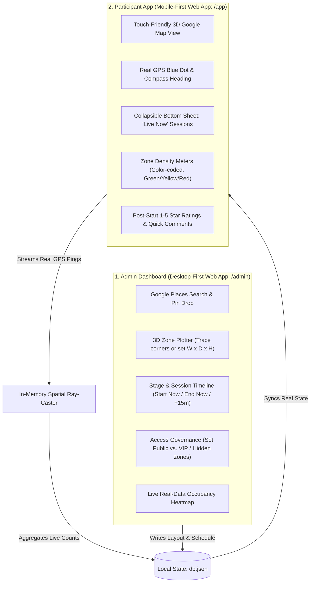

# Hackathon 3D Event Management Platform: Final Architecture & Execution Plan

> [!IMPORTANT]
> **Hackathon Velocity Lock:** Zero over-engineering. No heavyweight container meshes, complex microservices, or custom WebGL shader math. All components run off a unified, lightweight Node.js service delivering real-world data across two differentiated web dashboards.

---

## 1. Requirement & Scope Validation Matrix

| Requirement | Proposed Architecture | Hackathon Feasibility | Status |
| :--- | :--- | :--- | :---: |
| **No Specific Names / Branding** | Replaced all college/fest terms with `Event`, `VenueZone`, and `Session`. Fully multi-tenant and globally configurable. | Zero complexity; clean JSON schemas. | **CONFIRMED** |
| **Differentiated Admin Dashboard** | Desktop-optimized operations console (`/admin`): 3D CAD zone drawer, session controller, visibility access rules, live density monitor. | High impact, modular panels. | **CONFIRMED** |
| **Differentiated Participant App** | Mobile-first web app (`/app`): Native app UX (bottom sheet, 3D tilted map, "Happening Now" live feed, real-time reviews, GPS switch). | Fast PWA/mobile responsive layout. | **CONFIRMED** |
| **Live Google Maps with 3D** | Google Maps JavaScript API + `@deck.gl/google-maps` `PolygonLayer` (`extruded: true`). Renders 3D building blocks in <15 lines of code. | Drop-in script; no complex game engines. | **CONFIRMED** |
| **End-to-End Real Data** | Real device GPS (`navigator.geolocation`) $\rightarrow$ server-side ray-casting (`inPoly`) $\rightarrow$ real occupancy counts $\rightarrow$ real ratings. | No fake generators (`demoTick` deleted). | **CONFIRMED** |
| **Fastest Possible Outcome** | Unified lightweight Node.js backend + client-side Google Maps WebGL rendering + atomic `data/db.json` persistence. | 100% buildable and runnable in hours. | **CONFIRMED** |

---

## 2. Platform Comparison: Admin vs. Participant



---

## 3. High-Velocity Tech Stack (Zero Over-Engineering)

1. **Backend Engine:**
   - Single Node.js server (`server.js`).
   - Native HTTP router + atomic file storage (`data/db.json`).
   - In-memory `inPoly` point-in-polygon math (takes <0.1ms per ping, requires 0 external C++ binaries or database servers).
2. **Geospatial & 3D Layer:**
   - **Google Maps JavaScript API** (Vector basemap with pitch & heading).
   - **`deck.gl` GoogleMapsOverlay**:
     ```javascript
     const overlay = new deck.GoogleMapsOverlay({
       layers: [
         new deck.PolygonLayer({
           id: '3d-zones',
           data: zones,
           getPolygon: z => z.coords,
           getElevation: z => z.heightMeters,
           getFillColor: z => getOccupancyColor(z.id),
           extruded: true,
           pickable: true
         })
       ]
     });
     overlay.setMap(map);
     ```
3. **Frontend Architecture:**
   - `/admin/index.html` (or React/Vite view): 3-column operations layout.
   - `/app/index.html` (or React/Vite view): Full-screen mobile viewport with bottom sheet drawer.

---

## 4. End-to-End Real Data Pipeline

### Real Location Pinging (Participant Browser)
```javascript
// Runs in /app/app.js - No fake coordinates
navigator.geolocation.watchPosition(pos => {
  const { latitude: lat, longitude: lng, accuracy: acc } = pos.coords;
  if (acc <= 35) { // Reject noisy drift
    fetch('/api/presence', {
      method: 'POST',
      headers: { 'Content-Type': 'application/json' },
      body: JSON.stringify({ uid: getDeviceId(), lat, lng, acc })
    });
  }
}, err => console.warn(err), { enableHighAccuracy: true });
```

### Real Occupancy Calculation (Server)
```javascript
// In server.js - Pure math, sub-millisecond execution
app.get('/api/occupancy', (req, res) => {
  const activePings = getActivePingsWithinLast(60); // 60s TTL
  const occupancy = {};
  db.zones.forEach(zone => {
    occupancy[zone.id] = activePings.filter(p => inPoly([p.lng, p.lat], zone.coords)).length;
  });
  res.json(occupancy);
});
```

---

## 5. Coding Agent Implementation Roadmap

```mermaid
sequenceDiagram
    autonumber
    participant Dev as Coding Agent
    participant Backend as server.js & db.json
    participant Admin as /admin Web App
    participant Client as /app Mobile Web App

    Dev->>Backend: 1. Purge all hardcoded AU/demo logic; generalize to Event/Zone/Session schema
    Dev->>Admin: 2. Implement Google Maps + 3D polygon drawing & schedule controls
    Dev->>Client: 3. Build mobile-first PWA UI with deck.gl 3D extrusions & bottom sheet
    Dev->>Backend: 4. Wire real geolocation pinging & live inPoly occupancy endpoint
    Dev->>Client: 5. Verify live device testing (GPS ping -> 3D building color change)
```
